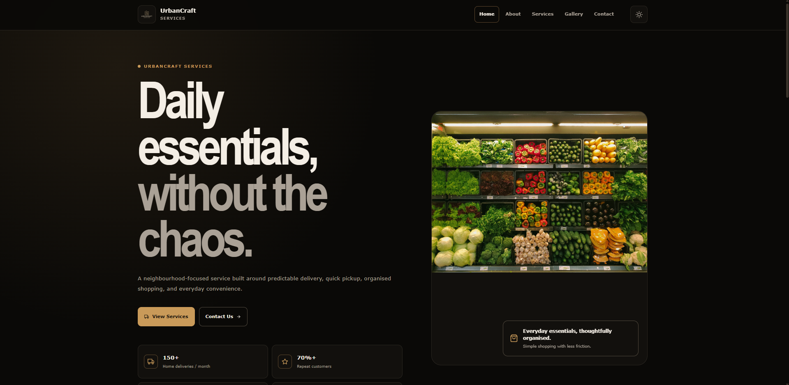

# UrbanCraft Services

UrbanCraft Services is a modern responsive local services website built with React and Vite. It presents home delivery, quick pickup, recurring orders, gallery content, contact information, and everyday customer support through a polished multi-page interface.



## Live Demo

https://a2rp.github.io/urbancraft-services/

## Features

- Responsive multi-page interface
- Fixed navigation header with active links
- Header hides on scroll down and returns on scroll up
- Dark and light theme support with saved preference
- Responsive mobile drawer navigation
- React lazy-loaded pages
- Route-level Suspense loading spinner
- Local image assets
- Spinner while individual images load
- Services and gallery data separated from page components
- Filterable image gallery
- Fullscreen gallery image modal
- Escape key and backdrop modal closing
- Smooth route scroll-to-top behavior
- Floating back-to-top button
- Accessible navigation and interactive controls
- SEO and social sharing metadata
- GitHub Pages deployment support

## Pages

- Home
- About
- Services
- Gallery
- Contact
- Not Found

## Tech Stack

- React 18
- React Router
- Vite
- styled-components
- React Icons
- JavaScript
- HTML5
- CSS3

## Project Structure

```text
src
├── assets
│   └── images
├── components
│   ├── backToTop
│   ├── drawerMenu
│   ├── footer
│   ├── header
│   ├── imageWithLoader
│   ├── loader
│   └── scrollToTop
├── data
│   ├── footerLinks.js
│   ├── galleryImages.js
│   ├── navigationLinks.js
│   └── services.js
├── pages
│   ├── about
│   ├── contact
│   ├── gallery
│   ├── home
│   ├── notFound
│   └── services
├── routes
│   └── AppRoutes.jsx
├── App.jsx
├── App.styled.js
├── index.css
├── main.jsx
└── theme.css
```

## Installation

```bash
git clone https://github.com/a2rp/urbancraft-services.git
cd urbancraft-services
npm ci
npm run dev
```

## Available Commands

```bash
npm run dev
npm run lint
npm run build
npm run preview
npm run deploy
```

## Deployment

The project is configured for GitHub Pages with the Vite base path:

```text
/urbancraft-services/
```

Run:

```bash
npm run deploy
```

## Accessibility

The interface includes semantic navigation, keyboard-accessible controls, visible focus states, descriptive image text, accessible mobile navigation, and keyboard support for the gallery modal.

## Future Prospects

- Connect the contact form to a real backend service
- Add live order and delivery functionality
- Add service availability by location
- Add customer accounts and order history
- Add a content management system for services and gallery media

## License

Licensed under the [MIT License](./LICENSE).

## Links

- [Portfolio](https://www.ashishranjan.net)
- [GitHub](https://github.com/a2rp)
- [CodePen](https://codepen.io/ash1198)
- [LinkedIn](https://www.linkedin.com/in/aashishranjan)
- [Facebook](https://www.facebook.com/theash.ashish)
- [YouTube](https://www.youtube.com/channel/UCLHIBQeFQIxmRveVAjLvlbQ)
- [Email](mailto:ash.ranjan09@gmail.com)

## Support

- [Support my work](https://a2rp-donation-page.netlify.app/)
- [Buy Me a Coffee](https://buymeacoffee.com/a2rp)
- [Patreon](https://www.patreon.com/a2rp)
